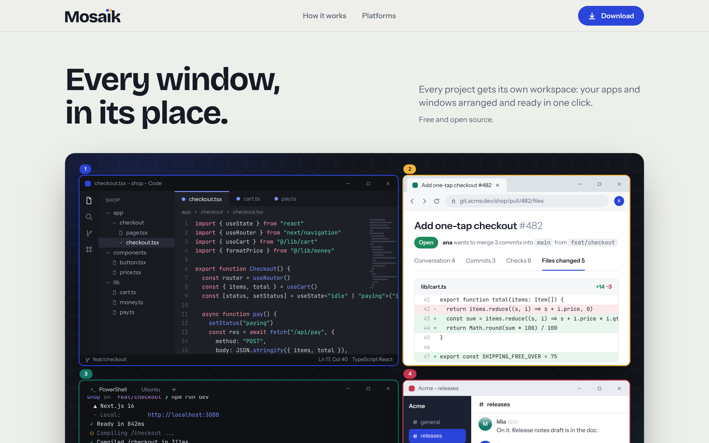
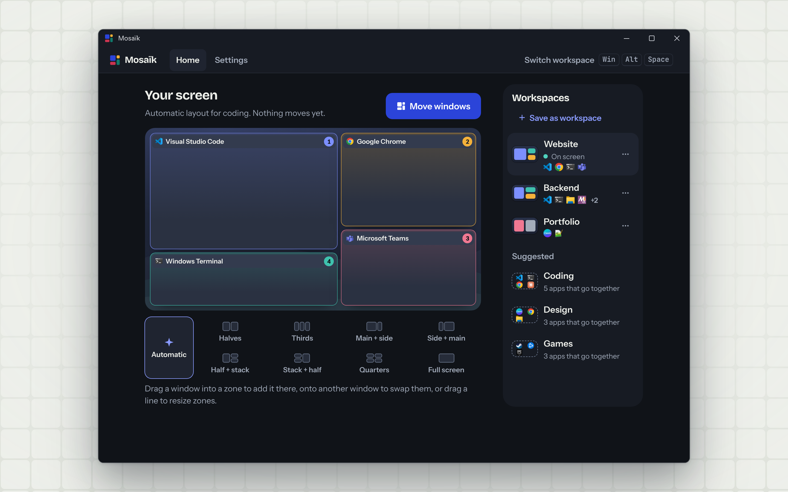
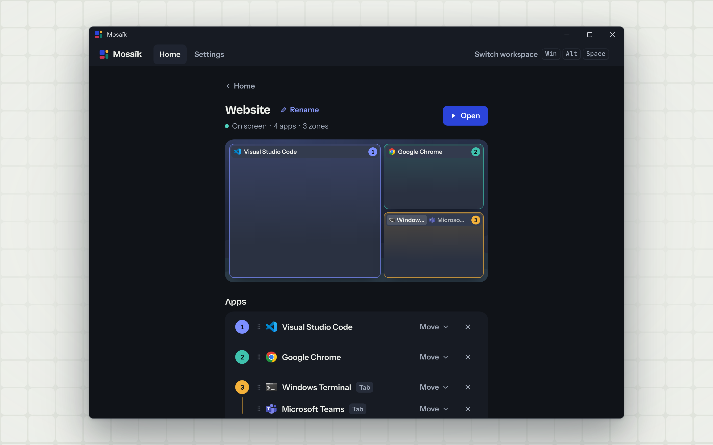
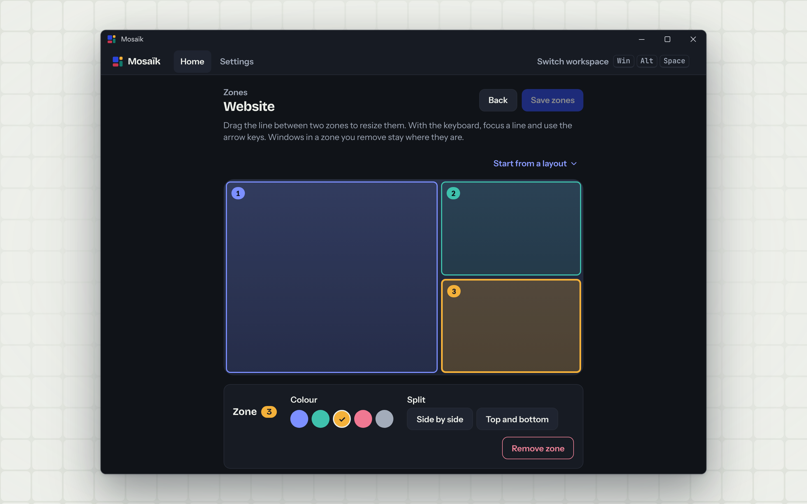

# Mosaïk

Window manager for Windows 11 and 10: zones, tabs for any app, workspaces in one click.

[mosaïk.com](https://mosaïk.com) · Rust · Tauri · React · TypeScript

<table>
<tr>
<td align="center" width="50%"> mosaïk.com</td>
<td align="center" width="50%"> Home</td>
</tr>
<tr>
<td align="center" width="50%"> A workspace</td>
<td align="center" width="50%"> Zones</td>
</tr>
</table>

Mosaïk gives every project its own workspace. Windows live in numbered, coloured zones that belong to the
project rather than the monitor, apps can share a tab strip, and one click brings back the positions,
sizes and tabs of a whole workspace, starting any app that is missing. It is free, makes no network
requests and keeps everything on your computer.

| | |
|:---|:---|
| **Zones** | Numbered, coloured areas that belong to the project; drag a window near one and it is pulled in |
| **Tabs for any app** | Drop a window on another's tag and they share a tab strip; pull one out and it is a window again |
| **Workspaces** | See where every window will go, then open it in one click; missing apps start |
| **Every monitor** | Zones are proportions, so they fit each monitor and scaling |

A watchdog process restores every hidden window if Mosaïk ever stops, and apps that cannot be resized
smaller than a zone are left alone and explained, never forced.

`mosaik.ps1` is the app in one file, its source inside; `mosaik.sh` writes and deploys the site. Code: `crates/` (logic, Windows, overlays, engine, watchdog, protocol), `apps/desktop` (the window), `docs/` ([architecture](docs/architecture.md), [status](docs/STATUS.md), [decisions](docs/adr)).

Public domain under [CC0 1.0](LICENSE); the software it is built with keeps its own licences ([notices](THIRD-PARTY-NOTICES.txt)). [Privacy and terms](https://xn--mosak-fta.com/conditions) · [Support on Patreon](https://www.patreon.com/gimzdev)

