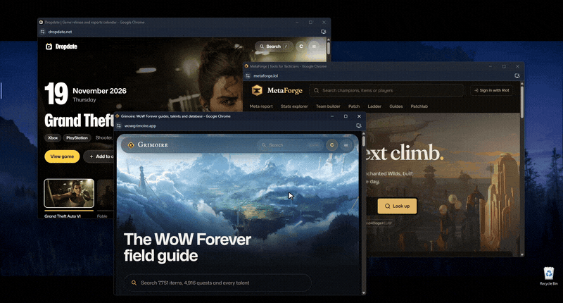
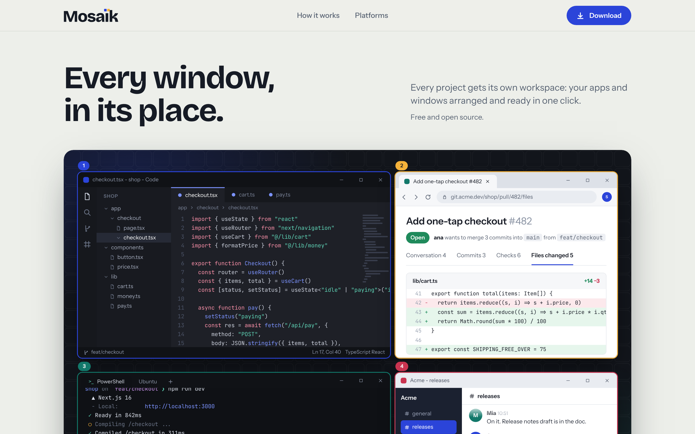
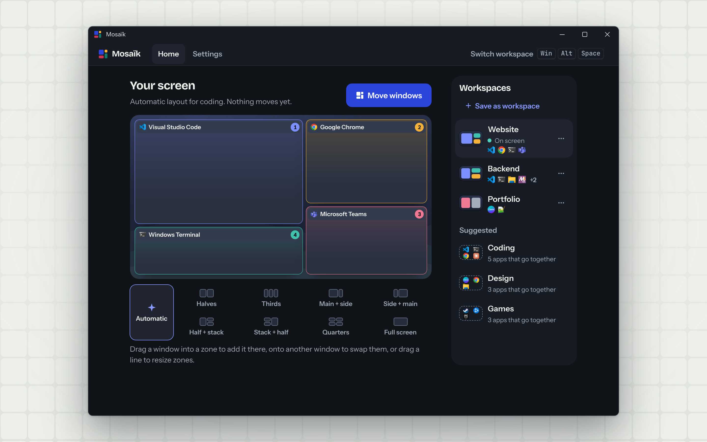
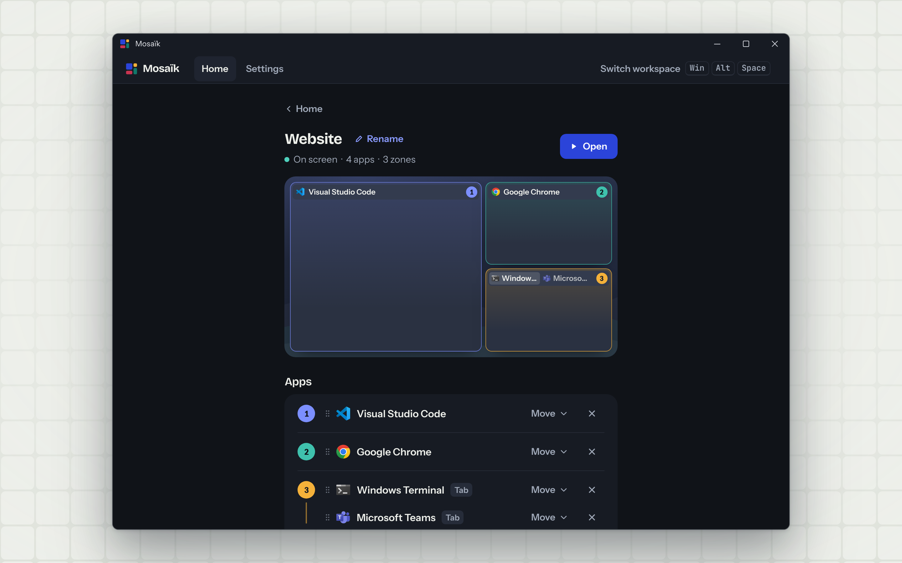
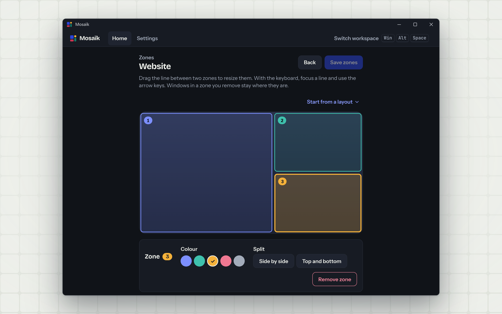

<h1 align="center">Mosaïk</h1>

<p align="center">Window manager for Windows</p>

<p align="center"><a href="https://apps.microsoft.com/detail/9PHR0L7S1QVD"></a></p>

<p align="center"><b><a href="https://xn--mosak-fta.com">mosaïk.com</a></b> · <a href="https://www.gimzdev.com/work/mosaik?utm_source=github">Case study</a></p>

<p align="center"></p>

Mosaïk gives every project its own workspace. Windows go in numbered, coloured zones that belong to the project
rather than the monitor, apps can share a tab strip, and one click brings back the positions, sizes and tabs of a
whole workspace, starting any app that is missing. It is free, makes no network requests and keeps everything on
your computer.

## Features

- **Zones.** Numbered, coloured areas that belong to the project. Drag a window near one and it is pulled in.
- **Tabs for any app.** Drop a window on another's tag and they share a tab strip. Pull one out and it is a window again.
- **Workspaces.** See where every window will go, then open it in one click. Missing apps start.
- **Arrange.** One click lays the windows out for what you are working on: the window you work in gets the most room. Or pick one of eight layouts.
- **Every monitor.** Zones are proportions, so they fit each monitor and scaling.
- **Private.** No account, no telemetry and no network request. Updates come through the Microsoft Store.

<p align="center">   </p>

## Built with

A Rust workspace (`crates/`) with a Tauri shell and a React and TypeScript interface (`apps/desktop`). The site in
`site/` is Next.js, written by `mosaik.sh`.

<details>
<summary>Implementation notes</summary>

- **Engine thread.** One thread makes every change to other apps' windows, in order, on a Win32 message loop. Moving a window is a synchronous call into its app, so each move goes to a short-lived thread and a hung app does not hold the engine up.
- **Watchdog.** Background tabs are hidden windows, so a watchdog process restores every hidden window if Mosaïk stops.
- **Core.** What a workspace saves, arranges and restores is decided by pure functions in `mosaik-core`, tested on every monitor fixture. The engine only gathers the windows and applies the result.
- **Limits.** An app that cannot be resized smaller than a zone is left alone, and Mosaïk says why.
- **Documents.** The design is in [docs/architecture.md](docs/architecture.md), the decisions in [docs/adr](docs/adr) and the state of the build in [docs/STATUS.md](docs/STATUS.md).

</details>

## Run it

To use it, install it from the Microsoft Store (the button above). To build it on Windows, in PowerShell:

```powershell
git clone https://github.com/gimzdev/mosaik.git
cd mosaik
.\mosaik.ps1 check    # what building needs; offers to install what is missing
.\mosaik.ps1 build    # the interface, then mosaik.exe, its watchdog and mosaikctl
.\mosaik.ps1 test     # the tests and checks
.\mosaik.ps1 run      # start the Mosaïk just built
```

`.\mosaik.ps1 pack` makes a one-file copy of the app, its source inside, to build on another PC. The site:
`./mosaik.sh --dir site` installs it and starts its dev server (`./mosaik.sh --help` lists every option).

## Licence and credits

Public domain under [CC0 1.0](LICENSE). The software it is built with keeps its own licences
([notices](THIRD-PARTY-NOTICES.txt)). [Privacy and terms](https://xn--mosak-fta.com/conditions).

<p align="center"><sub><a href="https://www.gimzdev.com/?utm_source=github">Gimz</a> · <a href="https://github.com/gimzdev/grimoire">Grimoire</a> · <a href="https://github.com/gimzdev/metaforge">MetaForge</a> · <a href="https://github.com/gimzdev/patchlab">Patchlab</a> · <a href="https://github.com/gimzdev/dropdate">Dropdate</a></sub></p>
